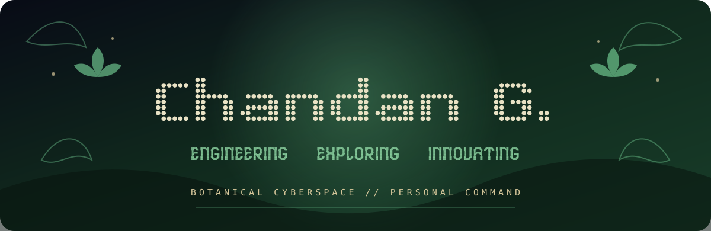
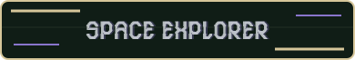

 <div align="center">




<br/>





</div>

---

<div align="center">

</div>

### `> WHO_AM_I.exe`

```yaml
Name: Chandan G.
Role: Developer | Cybersecurity Enthusiast | Space-Tech Explorer

Current_Focus:
  - C++ and Data Structures & Algorithms
  - Linux and Cybersecurity
  - Full-Stack Development
  - Space Technology and Mission Simulations

Mindset: Learn. Build. Break. Secure. Repeat.
Status: Always exploring new possibilities.
```

I am an enthusiastic developer fascinated by the intersection of technology, cybersecurity, and space exploration.

I enjoy building practical projects, experimenting with new technologies, solving problems, and transforming ambitious ideas into working applications.

My philosophy is simple: **Stay curious. Keep experimenting. Never stop building.**

---

<div align="center">

</div>

### `> CURRENT_MISSIONS`

| Mission | Objective | Status |
|---|---|---|
| C++ / DSA | Strengthen programming fundamentals and problem-solving | In Progress |
| Linux | Explore command-line tools and operating-system fundamentals | In Progress |
| Cybersecurity | Learn ethical hacking and security concepts | In Progress |
| Development | Build and improve practical applications | Ongoing |
| Space Technology | Explore spacecraft, satellites, and mission concepts | Exploring |

---

<div align="center">

</div>

### `> PROJECT_GARDEN`

Seven repositories. Different ideas. One continuous journey of building.

| Project | Description | Repository |
|---|---|---|
| **RageVoid_NASA** | NASA and space-related project | [Explore](https://github.com/chandangowda1202-spec/RageVoid_NASA) |
| **PRAVYAM_ScannerThreat** | SecureLens — sensitive information detection and redaction for documents | [Explore](https://github.com/chandangowda1202-spec/PRAVYAM_ScannerThreat) |
| **BGS_PRAVYAM-** | Pravyam project repository | [Explore](https://github.com/chandangowda1202-spec/BGS_PRAVYAM-) |
| **HackSHASHTRA_PRAVYAM** | Hackathon project developed by Team Pravidham | [Explore](https://github.com/chandangowda1202-spec/HackSHASHTRA_PRAVYAM) |
| **Pranveda** | Healthcare-focused project | [Explore](https://github.com/chandangowda1202-spec/Pranveda) |
| **pravidham-portfolio** | Team portfolio project | [Explore](https://github.com/chandangowda1202-spec/pravidham-portfolio) |
| **Important_Links** | Collection of useful links and resources | [Explore](https://github.com/chandangowda1202-spec/Important_Links) |

---

<div align="center">

</div>

### `> TECHNOLOGY_STACK`

**Programming Languages**

<p>

</p>

**Development & Tools**

<p>

</p>

**Exploring Next**

<p>

</p>

---

<div align="center">

</div>

### `> GITHUB_TELEMETRY`

<div align="center">


<br/><br/>


<br/><br/>


</div>

---

<div align="center">

</div>

### `> DEVELOPMENT_LOG`

```text
[BOOT]       Curiosity initialized.
[LEARN]      New concepts loading...
[BUILD]      Turning ideas into projects.
[DEBUG]      Every error is another lesson.
[IMPROVE]    Progress continues.
[STATUS]     MISSION IN PROGRESS.
```

---

<div align="center">


### `> ESTABLISH_CONNECTION`

<a href="https://github.com/chandangowda1202-spec">

</a>

<br/><br/>


<br/><br/>

**"The universe is vast. Curiosity is infinite. Keep building."**

<sub>TRANSMISSION COMPLETE // END OF FILE</sub>

</div>
